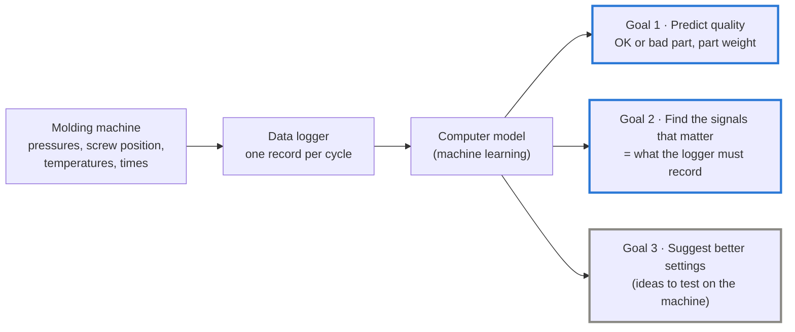
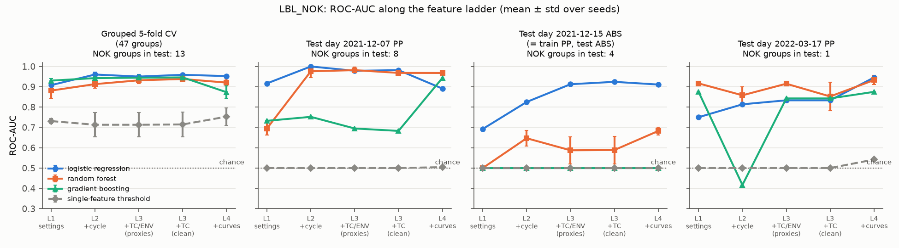
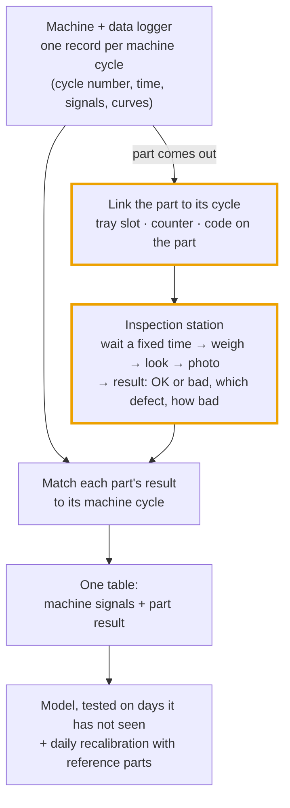

# Injection Molding Quality AI — a student research prototype

**Purpose: find out what data we need to collect on a plastic injection molding machine to spot bad parts and choose
better settings — using public datasets as the evidence.**

> **In 60 seconds**
>
> - **The question:** which machine signals and which part information should a data logger record, so that a
>   computer model can later flag bad parts and help choose settings?
> - **The data:** three public datasets from three different machines (I have no machine of my own yet) — details
>   [below](#the-three-datasets).
> - **The main result:** a short list of signals (screw position, melt pressure, clamp force, mold and coolant
>   temperatures, machine settings) plus five practical rules for labelling parts — see
>   [What we need to collect](#what-we-need-to-collect).
> - **What is still missing:** none of the public data shows *single* bad parts in normal, stable production, so that
>   case is not tested yet; choosing better settings (Goal 3) has not started.
> - **What I would like from you:** corrections and advice, especially on [three questions](#questions).

I am a mechanical engineering student. I have no machine, no simulation software and no partner shop yet, so
everything here is a desk study. The long-term goal is a small hardware + software product for molding shops: a data
logger plus a model that flags bad parts and helps with settings.

> **I am sharing this to get advice.**
> Corrections are very welcome — especially where my physics interpretation is wrong or where a real shop works
> differently.

**Reading time:** about 4 minutes for the first three sections (purpose, what to collect, how it fits together),
about 15 minutes for the whole page.
Unfamiliar words are explained in the **[glossary](docs/GLOSSARY.md)**.

---

## What we need to collect

This is the main product of the work so far. The evidence is further down and in
[the full signal table](results/tables/phase4_logger_signal_list.csv).

**Signals to record from the machine**

| Priority | Signal | How to record it |
|---|---|---|
| **Must** | [screw position](docs/GLOSSARY.md#screw-position) · [melt pressure](docs/GLOSSARY.md#melt-pressure) · [clamp force](docs/GLOSSARY.md#clamp-force) | as [curves](docs/GLOSSARY.md#curve-vs-per-cycle-value) recorded at least 100 times per second (100 [Hz](docs/GLOSSARY.md#hz)), plus one value per cycle ([cushion](docs/GLOSSARY.md#cushion), screw travel, peak pressure, holding-pressure level) |
| **Must** | mold temperature + [coolant](docs/GLOSSARY.md#mold-temperature-and-coolant) supply and return temperature for each mold half | one value per cycle |
| **Must** | all machine [setpoints](docs/GLOSSARY.md#setpoint), and every change with a time stamp | read from the machine controller (over [OPC-UA](docs/GLOSSARY.md#opc-ua) / [EUROMAP 77](docs/GLOSSARY.md#euromap-63-and-77)) |
| Should | injection speed · screw rotation and torque during [dosing](docs/GLOSSARY.md#dosing) | curves |
| Optional | one [cavity pressure](docs/GLOSSARY.md#cavity-pressure) sensor in the mold | only for molds where [short shots](docs/GLOSSARY.md#short-shot) are the main risk |
| Not needed | pump and flow values of the [temperature-control unit](docs/GLOSSARY.md#temperature-control-unit) · shop floor air temperature and humidity | — |

**Five practical rules — more important than any sensor**

- **Label every part, not every setting** — and weigh every part. (In the main public dataset all parts made with the
  same settings got the same label, which limits what it can show.)
- **Link each part to its machine cycle** reliably, for example with numbered tray slots, a counter, or a code on the
  part.
- **Record normal, stable production**, not only planned test runs — that is where single bad parts happen.
- **Log every cycle**, including warm-up after a setting change, with time stamp, material lot and mold ID.
- **Inspect a few reference parts every day** (weigh and check them) to [recalibrate](docs/GLOSSARY.md#recalibration)
  the model.

Step-by-step plan for collecting and labelling my own data: **[docs/DATA_COLLECTION_PLAN.md](docs/DATA_COLLECTION_PLAN.md)**.

---

## How the pieces fit together



The work was done in phases: **Phase 1** = check the data · **Goal 1** = Phases 2–3 · **Goal 2** = Phase 4 ·
**Goal 3** = Phase 5 (not started) · **Phase 6** = final report (later).

Goals 1 and 2 have a **first answer from public data**. It still has to be checked on real shop-floor data.

**"Success" here means honest numbers, not high numbers.** A [model](docs/GLOSSARY.md#model) can easily look
99 % right because it accidentally "cheats" ([leakage](docs/GLOSSARY.md#leakage-cheating)) — for example, it recognises
which settings a part was made with instead of judging the part's quality. A large part of the work was finding and removing
such shortcuts.

---

## The three datasets

In the code and file names the datasets are called `skz`, `polenta` and `leon`.

- **Main dataset (SKZ).** SKZ – Das Kunststoff-Zentrum (German Plastics Center) is a plastics research institute; its
  open ProBayes project with Fraunhofer IPA (a German applied-research institute for manufacturing) produced this
  dataset. A KraussMaffei 160-750PX machine made one test part (a "warpage shell") on three days: 7 Dec 2021 with
  [PP](docs/GLOSSARY.md#pp), 15 Dec 2021 with [recycled ABS](docs/GLOSSARY.md#abs-and-recycled-abs), 17 Mar 2022 with
  PP again. **Why I use it:** it has the richest signals — full machine curves recorded 200 times per second, a
  cavity pressure sensor, temperature-control data, a visual inspection of every part and its weight.
- **Dataset 2 (Polenta).** Published by Polenta et al. (2022) with production data from a lens maker
  (iGuzzini Illuminazione, Italy): road-lighting lenses from an Engel E-MAC 310/100 machine on 5 production days.
  It has 13 values per cycle from the factory's [MES](docs/GLOSSARY.md#mes) and 4 quality classes from a
  light-uniformity measurement. **Why I use it:** it is the only one from real production.
- **Dataset 3 (León).** Published by Pérez-González et al. (2026), University of León (Spain): a Mateu & Solé
  Minimat 60 machine made PP discs at 1000 different setting combinations, with part weight, energy and cycle time.
  **Why I use it:** many setting combinations, which is what Goal 3 (choosing settings) needs. Not used yet.

| Dataset | Size | Used for |
|---|---|---|
| Main dataset (SKZ) | 564 parts from 47 [setting points](docs/GLOSSARY.md#setting-point) (17 + 17 + 13 on the three days) | Goals 1 and 2: OK/bad and weight prediction, which signals matter |
| Dataset 2 (Polenta) | 1451 lenses | Goal 1: check on production data |
| Dataset 3 (León) | 1000 setting points ("batches"), 5 weighed parts each | Goal 3 (next step) |

**Two words used below:**

- A **setting point** is one combination of machine settings — one experiment. In the Main dataset (SKZ) it is about
  12 parts made in a row with the same settings (45 of the 47 setting points have exactly 12). The settings varied
  were cylinder (melt) temperature, mold temperature, injection speed, holding pressure, cooling time and
  [switchover](docs/GLOSSARY.md#switchover) volume, and on the March day also holding time and back pressure (see
  [settings per setting point](results/audit/skz_settings_by_group.csv)).
- **OK part / bad part:** some files say "NOK" ("not OK") for a bad part. In the Main dataset (SKZ) a part is bad if
  it has [sink marks](docs/GLOSSARY.md#sink-marks) (small surface dents from shrinkage) or is a
  [short shot](docs/GLOSSARY.md#short-shot) (not completely filled). Dataset 2 (Polenta) has four classes from a light
  measurement of each lens (uniformity U₀): **waste** (U₀ below 0.40, the lowest class), **acceptable** (0.40–0.45),
  **target** (0.45–0.50) and **inefficient** (above 0.50).

---

## Main results

### How to read the numbers

Every score below comes from testing the model on data it did **not** learn from: a different setting point
("unseen experiment") or a different day ("unseen day") — like testing a student on questions they have not seen,
not on the practice questions. A quick early test that mixed parts from the same setting point into learning and
testing gave a fake 100 %.

- **[AUC](docs/GLOSSARY.md#auc)** (0.5 to 1.0): how well the model ranks bad parts above OK parts.
  0.5 = guessing, 1.0 = perfect ranking.
- **[Balanced accuracy](docs/GLOSSARY.md#balanced-accuracy)** (0.5 to 1.0): the average of "share of bad parts caught"
  and "share of OK parts passed", after a [threshold](docs/GLOSSARY.md#threshold) turns scores into OK/bad decisions.

### OK or bad part

| Task | Result |
|---|---|
| Main dataset (SKZ), unseen setting points: bad part (sink marks or short shot) | AUC **0.96**, balanced accuracy **0.93** |
| Main dataset (SKZ), unseen setting points: sink marks / short shots on their own | AUC 1.00 / 0.94 |
| Dataset 2 (Polenta): waste vs acceptable lens, made with the same machine settings | AUC **0.93** (after removing the rows I consider suspicious, see below) |
| Main dataset (SKZ), **unseen day or new material** | ranking still good (AUC 0.83–0.98), but the **threshold fails** (balanced accuracy 0.46–0.80) |

> **Caution — what these numbers do and do not show.** In the Main dataset (SKZ) the labels describe the whole
> setting point, not each single part: all ~12 parts of a setting point are either all OK or all bad. So the results
> show that **setting points that produce bad parts can be recognised** from machine signals. They do **not** show
> that a single bad part can be caught in stable production. Dataset 2 (Polenta) is closer to that question, but its
> classes also partly follow the machine settings (see [traps](#traps-i-found-in-the-data)).



*How to read this figure:* from left to right inside each panel, more signals are given to the model (settings only →
plus per-cycle values → plus temperature-control data, shown once with and once without the signals that only identify
the day → plus curves). The left panel tests on unseen setting points,
the other three on an unseen day. "NOK" in the figure means bad part.

On the new ABS day the model still ranks the parts correctly, but all its scores are tiny, so a threshold learned on
PP calls every ABS part "OK". **Practical meaning: a real system needs a short
[recalibration](docs/GLOSSARY.md#recalibration) per material and start-up**, using a few inspected parts.

### Part weight

Part weight can be predicted to about ±0.5 g (the parts weigh 86–113 g).

- **Within a day**, using machine curves (screw position, screw rotation, clamp force): average error about 0.48 g.
- **On a new day with the same plastic (PP)**, the best predictor was **physics, not machine learning**: the injected
  mass calculated from the screw travel and the plastic's density (a [pVT model](docs/GLOSSARY.md#pvt-model)) followed
  the real weight with [r](docs/GLOSSARY.md#correlation-r) = 0.98 and an error of 0.5–1.0 g, while the machine-learning
  models were off by several grams.
- Predicting the weight of ABS parts from PP data did not work at all.


### Which signals matter

I grouped every calculated value by the physical signal it comes from, and asked many times, always on unseen data:
*"If the logger may record only 3 signals, which 3 should it be?"*


*How to read this figure:* each percentage is how often a signal was among the 3 chosen. "Underfilled" = short shot;
"waste" = Dataset 2 (Polenta)'s lowest class; "not logged" = that dataset does not record the signal.

In plain words:

- **Melt pressure** (especially while holding pressure is applied) is the strongest general signal for bad parts.
  It shows how well the part is packed with plastic while it shrinks; too little packing causes sink marks. In
  Dataset 2 (Polenta) the peak injection pressure separates waste from acceptable lenses.
- **Screw position** (cushion, how far the screw travelled while injecting and dosing) → how much plastic went in →
  part weight.
- **Cavity pressure** is the best signal for **short shots**, but it needs a sensor in the mold.
- **Clamp force** works as a cheap stand-in for cavity pressure: the plastic pushes the mold halves apart a little,
  and the clamp force shows it.
- **Mold and coolant temperature** (the supply–return difference shows the heat taken out) matter for sink marks.
- Shop floor air, temperature-control pump values and most timers add nothing: they only tell which day or which
  setting point it was.
- **OK/bad** was predicted just as well from simple per-cycle values (peak, cushion, holding level);
  **part weight needs the full curves**.

### Traps I found in the data

These are **my observations from reading the data**, not a judgment of the dataset authors. The evidence is in the
[data check notes](results/audit/PHASE1_SUMMARY.md).

- **Main dataset (SKZ): labels describe the setting point, not the part** (see the caution above).
- **Main dataset (SKZ): in my reading, five recorded setpoints look wrong** — for example, holding pressure recorded as
  200 bar where the machine's measured value was 60 bar. The measured values agree with the published experiment plan,
  so I used the plan's values. This changed the results a lot.
- **Some signals only tell the day apart.** For example, shop floor humidity stayed at 70 % all day on one day, and the
  machine's oil temperature rises all day as the machine warms up. A model can use them to "recognise the day", which
  looks good but means nothing.
- **Dataset 2 (Polenta): the file is sorted by quality class**, not by time. In my reading, many waste rows look
  synthetic: they contain values with more decimal places than the machine can record
  ([evidence](results/audit/audit_polenta_leon.txt)). I report the results without those rows.
- **Dataset 2 (Polenta): cycle time differs between groups of classes** — waste and acceptable lenses were made at
  about 74.8 s, target and inefficient lenses at about 75.7 s. So part of the 4-class result is the model
  recognising the machine settings ([evidence](results/PHASE4_SUMMARY.md)).

---

## How I plan to collect my own data



Details — signals, linking parts to cycles, labelling rules, experiment plan:
**[docs/DATA_COLLECTION_PLAN.md](docs/DATA_COLLECTION_PLAN.md)**.

---

## Questions

I would be very grateful for your view (open an issue on this repository, or just tell me):

- **Clamp force instead of a cavity pressure sensor:** is that reliable in practice? Does it depend on a toggle or
  hydraulic clamp ([what is that?](docs/GLOSSARY.md#toggle-vs-hydraulic-clamp)), mold size, or number of cavities?
- **Linking each part to its machine cycle:** how do shops do it today, if at all? Is a counter or date insert in
  the mold, or a printed code, realistic?
- **Getting data from a shop:** would a shop let a student log a machine for a few days and label parts? What would
  make that easy and worth it for them?

<details>
<summary><b>More questions</b> (click to open)</summary>

- **Sink marks:** my data says holding-pressure level and how it falls over time, mold temperature and cushion matter
  most. Does that match your experience? What am I missing (gate freeze time, wall thickness, …)?
- **Machine interfaces:** in the shops you know, what can realistically be read from the machine — one value per
  cycle only ([EUROMAP 63/77, OPC-UA](docs/GLOSSARY.md#euromap-63-and-77)), or also curves at 100 Hz or more? How old
  are typical machines?
- **Bad parts in stable production:** which defects cost the most money, and how often do they occur (per 1000
  parts)? Is part weight a good enough quality check, or where does it fail?
- **Start-up and drift:** what does a shop do today at start-up or after a material change (check the first part,
  scrap the first shots)? Would "inspect 5–10 reference parts per day" be accepted?
- **Cavity pressure sensors:** when are they worth the cost, and what do they cost installed?
- **Anything in my results that looks physically wrong to you?**

</details>

---

## Limits — please read before trusting any number

- Each dataset comes from **one machine and one mold**. Nothing here is proven to work on another mold.
- The Main dataset (SKZ) has only **47 setting points**, many at extreme ends of the process window.
- **The shuffling check:** for the OK/bad task in the Main dataset (SKZ), I mixed up the labels at random and
  retrained the model 20 times ([shuffling check](docs/GLOSSARY.md#shuffling-check)). With random labels the AUC was
  0.51 on average, stayed at about 0.64 or below in 19 of the 20 runs, and reached 0.73 once — purely by luck. So in
  this dataset **an AUC around 0.65 means nothing**; only scores clearly above that show a real pattern.
- **Read very high scores with care.** AUC 1.00 for sink marks means the 12 setting points with sink marks were
  ranked perfectly above the other 35 in this test. With so few setting points, labels per setting point and extreme
  settings, a perfect score is much easier here than on a real shop floor; it does not mean sink marks will always be
  caught. The technical notes say holding pressure and related values explain sink marks almost completely
  [TODO: confirm with Kerem whether this is the physical reason for the perfect score].
- Dataset 2 (Polenta) has **no time stamps**, and in my reading part of its waste class looks synthetic; I report the
  numbers without those rows.
- "Important for the model" is **not proof of cause**. The physics explanations fit the data but were not tested by
  dedicated experiments.
- Setting suggestions (Goal 3, coming) will be **ideas to test** until someone runs them on a machine.

---

## Technical notes (for specialists)

These were written as working notes during the analysis ("you" in them means me, the project owner):
[Phase 1 – data check](results/audit/PHASE1_SUMMARY.md) · [Phase 2 – OK/bad and weight prediction](results/PHASE2_SUMMARY.md) ·
[Phase 3 – production check](results/PHASE3_SUMMARY.md) · [Phase 4 – which signals matter](results/PHASE4_SUMMARY.md).

---

## How to run the code

```bash
# Python 3.11+ (developed with 3.13)
python -m venv .venv
.venv\Scripts\activate            # Windows  (Linux/macOS: source .venv/bin/activate)
pip install -r requirements.txt   # exact versions: requirements-lock.txt
```

### Getting the data

The raw data is **not** in this repository (licences and size). Download it yourself and set `IMAI_DATA_ROOT` to the
folder that contains it (default: the folder one level above this repository):

| Dataset | Source | Expected path under `IMAI_DATA_ROOT` |
|---|---|---|
| Main dataset (SKZ), version 2 | B2SHARE (EUDAT), record `k0v7s-jf859` | `ZIPS/k0v7s-jf859/dataset_V2.parquet` |
| Dataset 2 (Polenta) | repository linked from the paper, [doi:10.3390/info13060272](https://doi.org/10.3390/info13060272) | `ZIPS/machine-learning-for-quality-prediction-in-plastic-injection-molding-master/machine-learning-for-quality-prediction-in-plastic-injection-molding-master/dataset/data.csv` |
| Dataset 3 (León) | [Zenodo, doi:10.5281/zenodo.20309380](https://doi.org/10.5281/zenodo.20309380) (`Dataset.csv`, renamed) | `02 Datasets/LeonPP.csv` |

### Scripts (run from the repository folder, in this order)

| Step | Script | Time |
|---|---|---|
| Data check (Phase 1) | `scripts/audit_skz.py`, `scripts/audit_polenta_leon.py` | seconds |
| Phase 2 | `scripts/phase2_skz_classification.py`, `phase2_skz_regression.py`, `phase2_report.py` | ~35 min on 12 cores |
| Phase 3 | `scripts/phase3_polenta.py`, `phase3_report.py` | ~12 min |
| Phase 4 | `scripts/phase4_skz.py`, `phase4_polenta.py`, `phase4_polenta_waste_vs_acceptable.py`, `phase4_logger_check.py`, `phase4_report.py` | ~30 min |

All random seeds are fixed, so every table and figure in `results/` can be regenerated.

### Repository layout

```
src/        loading the data, calculating values from the curves, models and testing, signal grouping
scripts/    one script per step; each writes to results/
results/    technical notes (*.md), tables (csv), figures (png)
docs/       glossary and the data collection plan for my own dataset
```

---

## Credits

- Main dataset (SKZ): SKZ – Das Kunststoff-Zentrum and Fraunhofer IPA, project "ProBayes" (dataset version 2 and data
  description).
- Dataset 2 (Polenta): A. Polenta, S. Tomassini, N. Falcionelli, P. Contardo, A. F. Dragoni, P. Sernani, *A Comparison
  of Machine Learning Techniques for the Quality Classification of Molded Products*, Information 13(6):272, 2022.
- Dataset 3 (León): J. Pérez-González et al., *Multi-Objective optimization of injection molding parameters: an
  experimental SHAP-Guided memetic NSGA-II approach*, Int. J. Adv. Manuf. Technol., 2026; dataset on Zenodo
  (CC BY 4.0).

Analysis code written with the help of Claude (Anthropic) as a coding assistant; all choices and conclusions were
reviewed step by step.
