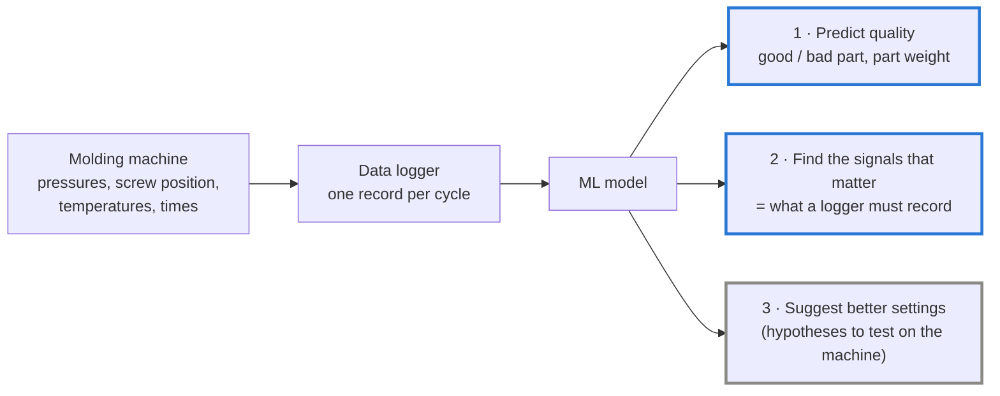
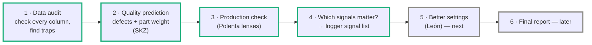
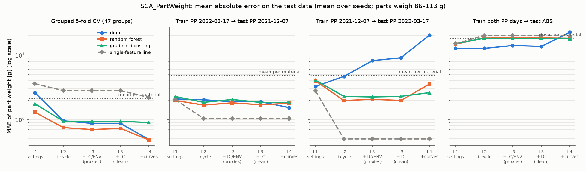
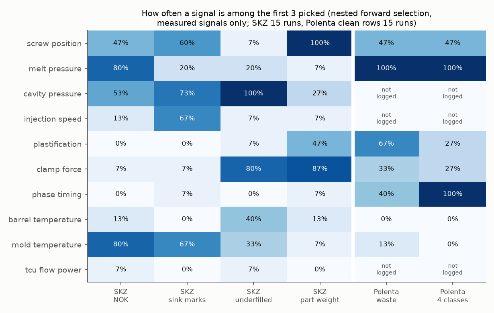
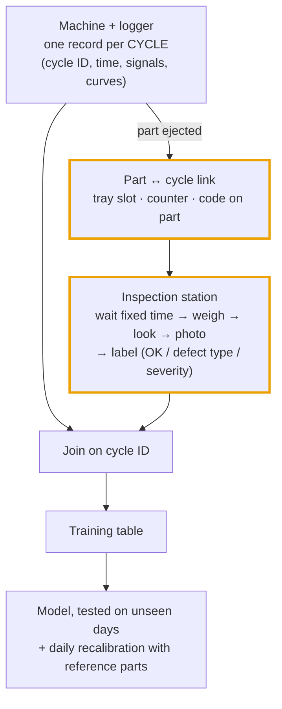

# Injection Molding Quality AI — a student research prototype

**Can machine data tell us whether a molded part is good, which signals we really need to record, and which settings would work better?**

This repository is my attempt to answer that, honestly, using only public datasets. I am a mechanical engineering
student. I have no machine, no simulation license and no partner shop yet, so everything here is a desk study.
The long-term goal is a small hardware + software product for molding shops: a data logger plus a model that
flags bad parts and helps with settings.

> **I am sharing this to get advice.**
> If you have 15 minutes, read [What I found](#what-i-found) and answer any of the
> [questions at the end](#questions-for-experienced-engineers). Corrections are very welcome — especially
> where my physics interpretation is wrong or where a real shop works differently.

---

## The idea in one picture



Goals 1 and 2 are done (on public data). Goal 3 is next.

**"Success" here means honest numbers, not high numbers.** In machine learning it is very easy to get a model that
looks 99 % accurate because it accidentally "cheats" (for example, it recognises which experiment a part came from
instead of the part's quality). A large part of the work was finding and removing such shortcuts.

---

## The data I used (all public)

| Dataset | What it is | Size | Used for |
|---|---|---|---|
| **SKZ / Fraunhofer IPA** ("ProBayes") | KraussMaffei 160-750PX, one part ("warpage shell"), PP and recycled ABS, designed experiments on 3 days. Full machine curves at 200 Hz, cavity pressure, temperature-control units, visual defect labels, part weight | 564 parts from **47 setting points** | Main development: defect and weight prediction, signal importance |
| **Polenta et al. 2022** | Engel E-MAC 310/100, road-lighting lenses, real production on 5 days. 13 cycle values from the MES, 4 optical quality classes | 1451 lenses | Production check |
| **León PP (Pérez-González et al. 2026)** | Mateu & Solé Minimat 60, PP discs, 1000 setting combinations; weight of 5 parts, energy, cycle time | 1000 batches | Setting optimisation (next step) |

---

## What I did



The rule in every step: **the model is always tested on experiments (or days) it has never seen.** A random split of
parts would let the model see 11 parts of an experiment in training and the 12th in the test — that is cheating, and it
gave a fake 100 % in a quick early test.

Detailed write-ups: [Phase 1 audit](results/audit/PHASE1_SUMMARY.md) ·
[Phase 2](results/PHASE2_SUMMARY.md) · [Phase 3](results/PHASE3_SUMMARY.md) · [Phase 4](results/PHASE4_SUMMARY.md)
(these are working notes written during the analysis; "you" in them means me, the project owner).

---

## What I found

### 1. The data had traps that would have produced wrong results

- **SKZ labels describe the setting, not the part.** In every one of the 47 experiments, either all ~12 parts are
  labelled good or all are labelled bad. So the model can only learn "which settings make bad parts" — it never sees
  the case that matters most in a shop: *one bad part in a stable run*.
- **Five recorded setpoints were wrong** (e.g. holding pressure 200 bar recorded where the machine actually ran 60 bar).
  The measured values agreed with the experiment plan, so I corrected them. This alone changed the results a lot.
- **Some signals only tell the day apart** (hall humidity was fixed at 70 % on one day, oil temperature rises all day
  as the machine warms up). A model can use them to "recognise the day", which looks good but means nothing.
- **Polenta's file is sorted by quality class**, many "waste" rows contain values with more decimals than the machine
  can log (they look synthetic), and cycle time differs between groups of classes (they were made with different settings).

### 2. Bad parts can be predicted — but the decision threshold does not carry over

| Task (tested on unseen experiments) | Result |
|---|---|
| SKZ: bad part (sink marks or short shot) | AUC **0.96**, balanced accuracy **0.93** |
| SKZ: sink marks / short shots separately | AUC 1.00 / 0.94 |
| Polenta: waste vs acceptable lens, same machine setting | AUC **0.93** (after removing suspicious rows) |
| SKZ: same model on a **new day or material** | ranking still good (AUC 0.83–0.98), but the good/bad **cut-off fails** |

*AUC = how well the model ranks bad parts above good ones (0.5 = guessing, 1.0 = perfect).
Balanced accuracy = average of "bad parts caught" and "good parts passed".*


The left panel is "unseen experiments", the other panels are "unseen day". On the new ABS day, the model still ranks
parts correctly, but every probability is tiny, so a threshold learned on PP calls every ABS part "OK".
**Practical meaning: a real system needs a short recalibration per material / start-up** (a few inspected parts).

### 3. Part weight can be predicted to about ±0.5 g (parts weigh 86–113 g)

- Within a day, using the **machine curves** (screw position, screw rotation, clamp force): error ≈ 0.48 g.
- On a new day, the best predictor was **physics, not ML**: shot mass from screw stroke × melt density (pVT model)
  predicted weight with r = 0.98 and 0.5–1.0 g error, while the ML models were off by several grams.



### 4. Which signals matter

I grouped every feature by the physical signal it comes from and asked, many times on unseen data: *"If the logger may
record only 3 signals, which 3 should it be?"*



In plain words:

- **Melt / hydraulic pressure** (especially the holding phase) is the strongest general signal → packing, sink marks;
  in the lens data the injection pressure peak separates waste from acceptable lenses.
- **Screw position** (cushion, injected and dosed stroke) → shot volume → part weight.
- **Cavity pressure** is the best signal for **short shots**, but it needs a sensor in the mold.
- **Clamp force** works as a cheap stand-in for cavity pressure (the melt pushes the mold halves apart).
- **Mold / coolant temperature** (supply–return difference = heat taken out) matters for sink marks.
- Hall air, temperature-control pump values and most timers add nothing (they only identify the day or the setting).
- **Defects** were predicted just as well from simple per-cycle values (peak, cushion, holding level);
  **weight needs the full curves**.

---

## What is really needed

**Signals** (full table with evidence: [phase4_logger_signal_list.csv](results/tables/phase4_logger_signal_list.csv))

| Priority | Signal | How |
|---|---|---|
| **Must** | screw position · melt/hydraulic pressure · clamp force | curves ≥ 100 Hz + per-cycle values (cushion, strokes, peaks, holding level) |
| **Must** | mold temperature + coolant supply/return temperature per mold half | once per cycle |
| **Must** | all setpoints + every change, with time stamp | from the controller (OPC-UA / EUROMAP 77) |
| Should | injection speed · screw rotation and torque during dosing | curves |
| Optional | one cavity pressure sensor | only for molds where short shots are the main risk |
| Not needed | temperature-control pump/flow values · hall temperature/humidity | — |

**More important than any sensor:**

1. **Label every part**, not every setting — and weigh every part.
2. **A reliable link between each part and its machine cycle** (tray slots, counter, or a code on the part).
3. **Record normal, stable production**, not only designed experiments — that is where single bad parts happen.
4. **Log every cycle** (also warm-up after a setting change), with time stamp, material lot and mold ID.
5. **A few reference parts per day** (weighed and inspected) to recalibrate the model.

---

## How I plan to do it in the future (own dataset)



Step-by-step plan, labelling rules and the experiment plan: **[docs/DATA_COLLECTION_PLAN.md](docs/DATA_COLLECTION_PLAN.md)**.

---

## Questions for experienced engineers

I would be very grateful for your view on any of these (open an issue, or just tell me):

1. **Sink marks:** my data says holding-pressure level/slope, mold temperature and cushion matter most. Does that match
   your experience? What am I missing (gate freeze time, wall thickness, …)?
2. **Clamp force as a cavity-pressure substitute:** is that reliable in practice? Does it depend on toggle vs.
   hydraulic clamp, mold size, number of cavities?
3. **Machine interfaces:** in the shops you know, what can realistically be read from the machine — per-cycle values
   only (EUROMAP 63/77, OPC-UA), or also curves at 100+ Hz? How old are typical machines?
4. **Linking parts to cycles:** how do shops do it today (if at all)? Is a counter/date insert or marking realistic?
5. **Defects in stable production:** which defects actually cost the most money, and how often do they occur
   (per 1000 parts)? Is part weight a good enough quality proxy, or where does it fail?
6. **Drift and start-up:** what does a shop do today at start-up or material change (first-article check, scrap the
   first N shots)? Would "inspect 5–10 reference parts per day" be accepted?
7. **Cavity pressure sensors:** when are they worth the cost, and what do they cost installed?
8. **Getting data:** would a shop let a student log a machine for a few days and label parts? What would make that
   easy and worth it for them?
9. **Anything in my results that looks physically wrong to you?**

---

## Limits (please read before trusting any number)

- Each dataset is **one machine and one mold**. Nothing here is proven to transfer to another mold.
- SKZ has only **47 setting points**, many at extreme corners of the process window. With so few, an AUC up to
  ~0.65 can appear by pure chance (checked by shuffling labels).
- Polenta has **no time stamps**, and part of its waste class looks synthetic; I report the cleaned numbers.
- "Important for the model" is **not proof of cause**. The physics explanations fit the data but were not tested by
  dedicated experiments.
- Setting recommendations (Phase 5, coming) will be **hypotheses** until someone runs them on a machine.

---

## How to run the code

```bash
# Python 3.11+ (developed with 3.13)
python -m venv .venv
.venv\Scripts\activate            # Windows  (Linux/macOS: source .venv/bin/activate)
pip install -r requirements.txt   # exact versions: requirements-lock.txt
```

### Getting the data

The raw data is **not** in this repository (licences and size). Download it yourself and set `IMAI_DATA_ROOT` to the
folder that contains it (default: the folder one level above this repository):

| Dataset | Source | Expected path under `IMAI_DATA_ROOT` |
|---|---|---|
| SKZ / Fraunhofer IPA, dataset V2 | B2SHARE (EUDAT), record `k0v7s-jf859` | `ZIPS/k0v7s-jf859/dataset_V2.parquet` |
| Polenta et al. 2022 | repository linked from the paper, [doi:10.3390/info13060272](https://doi.org/10.3390/info13060272) | `ZIPS/machine-learning-for-quality-prediction-in-plastic-injection-molding-master/machine-learning-for-quality-prediction-in-plastic-injection-molding-master/dataset/data.csv` |
| León PP | [Zenodo, doi:10.5281/zenodo.20309380](https://doi.org/10.5281/zenodo.20309380) (`Dataset.csv`, renamed) | `02 Datasets/LeonPP.csv` |

### Scripts (run from the repository folder, in this order)

| Step | Script | Time |
|---|---|---|
| Audit | `scripts/audit_skz.py`, `scripts/audit_polenta_leon.py` | seconds |
| Phase 2 | `scripts/phase2_skz_classification.py`, `phase2_skz_regression.py`, `phase2_report.py` | ~35 min on 12 cores |
| Phase 3 | `scripts/phase3_polenta.py`, `phase3_report.py` | ~12 min |
| Phase 4 | `scripts/phase4_skz.py`, `phase4_polenta.py`, `phase4_polenta_waste_vs_acceptable.py`, `phase4_logger_check.py`, `phase4_report.py` | ~30 min |

All random seeds are fixed, so every table and figure in `results/` can be regenerated.

### Repository layout

```
src/        loaders, feature building (curve features per phase), models + validation, signal map
scripts/    one script per step; each writes to results/
results/    summaries (*.md), tables (csv), figures (png)
docs/       data collection plan for the next, own dataset
```

---

## Credits

- SKZ – Das Kunststoff-Zentrum and Fraunhofer IPA, project "ProBayes" (dataset V2 and data description).
- A. Polenta, S. Tomassini, N. Falcionelli, P. Contardo, A. F. Dragoni, P. Sernani, *A Comparison of Machine Learning
  Techniques for the Quality Classification of Molded Products*, Information 13(6):272, 2022.
- J. Pérez-González et al., *Multi-Objective optimization of injection molding parameters: an experimental
  SHAP-Guided memetic NSGA-II approach*, Int. J. Adv. Manuf. Technol., 2026; dataset on Zenodo (CC BY 4.0).

Analysis code written with the help of Claude (Anthropic) as a coding assistant; all choices and conclusions were
reviewed step by step.
