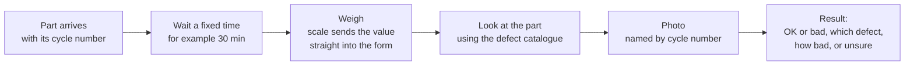

# Data collection plan for my own dataset

This plan turns the lessons from the three public datasets into a recipe for collecting data on a real machine.
The public datasets were weakest **not in their sensors, but in how parts were labelled and linked to their machine
cycles**, so most of this plan is about that. Unfamiliar words are explained in the [glossary](GLOSSARY.md); back to
the [README](../README.md).

**The one rule:** every [cycle](GLOSSARY.md#cycle) is logged, every part gets a [label](GLOSSARY.md#label)
(OK or bad, which defect, weight), and every part can be traced back to its cycle.

---

## 1. Machine signals

| Priority | What to record | How often | Why (evidence in the [Phase 4 technical note](../results/PHASE4_SUMMARY.md)) |
|---|---|---|---|
| **Must** | [Screw position](GLOSSARY.md#screw-position), [melt pressure](GLOSSARY.md#melt-pressure), [clamp force](GLOSSARY.md#clamp-force) — full [curves](GLOSSARY.md#curve-vs-per-cycle-value), plus the machine's own markers for each phase (injection / holding / dosing / cooling) | at least 100 times per second (100 [Hz](GLOSSARY.md#hz)) | strongest signals for bad parts (pressure) and for part weight (screw position, clamp force) |
| **Must** | One value per cycle: [cushion](GLOSSARY.md#cushion), how far the screw travels while injecting and while [dosing](GLOSSARY.md#dosing), [switchover](GLOSSARY.md#switchover) position, peak injection pressure, [holding pressure](GLOSSARY.md#holding-pressure), all phase times, cycle time | every cycle | OK/bad was predicted as well from these as from full curves |
| **Must** | Mold temperature + [coolant](GLOSSARY.md#mold-temperature-and-coolant) supply and return temperature for each mold half | every cycle | mold temperature and heat removal matter for [sink marks](GLOSSARY.md#sink-marks) |
| **Must** | All machine [setpoints](GLOSSARY.md#setpoint), and every change with time stamp and who changed it | on every change | needed to know the [setting point](GLOSSARY.md#setting-point), to test honestly, and later to improve settings |
| Should | Injection speed curve, screw rotation and torque during dosing | at least 100 Hz | sink marks; amount of plastic dosed and state of the melt |
| Should | Barrel and nozzle heater temperatures (measured values) | every cycle | background information and spotting slow changes over time (drift) |
| Optional | One [cavity pressure](GLOSSARY.md#cavity-pressure) sensor (near the end of the flow path) | at least 100 Hz | best signal for [short shots](GLOSSARY.md#short-shot); worth it only where short shots are the main risk |
| Skip | Pump, flow and power values of the [temperature-control unit](GLOSSARY.md#temperature-control-unit); shop floor air temperature and humidity | — | added nothing; at most note the shop floor climate once per shift |

**Two hardware levels:**

- **Level 1 (cheap):** read one value per cycle and the setpoints from the machine controller
  ([OPC-UA](GLOSSARY.md#opc-ua) / [EUROMAP 77 or 63](GLOSSARY.md#euromap-63-and-77)), plus two temperature sensors
  (thermocouples) per coolant circuit. Enough to tell OK from bad setting points.
- **Level 2:** add fast curves for screw position, pressure and clamp force (through the machine's high-speed
  interface, or by tapping the sensor signals directly). Needed for good weight prediction.

---

## 2. Linking each part to its cycle (the hardest practical step)

| Method | Effort | Reliability |
|---|---|---|
| **Numbered trays:** parts placed in slots in order; first cycle number written on the tray; a check part marked every 50 cycles | low | medium — breaks if a part drops or a cycle is skipped |
| **Conveyor + light-barrier counter**, matched to the machine's cycle counter | medium | good |
| **Mark the part:** a date/counter insert in the mold, or a laser or inkjet code printed when the part comes out | higher | best |

**Test the link on about 100 parts before the real data collection:** check that the part weights line up with the
shot sizes the machine recorded. A link that is off by one part silently ruins the whole dataset.

---

## 3. Inspection station and labelling rules

- **Fixed waiting time** before weighing and measuring, because weight and size change while the part cools.
- **Defect catalogue with reference photos:** for each defect type ([sink marks](GLOSSARY.md#sink-marks),
  [short shot](GLOSSARY.md#short-shot), flash = thin extra plastic at the mold edges, streaks, burn marks,
  [warpage](GLOSSARY.md#warpage)) show an "OK", a "borderline" and a "bad" example. This keeps labels consistent
  between people and days.
- **How bad, not only yes/no:** 0 = none, 1 = visible but acceptable, 2 = reject. Levels can be merged later, but
  never split afterwards.
- **"Unsure" is allowed** — better than a forced guess.
- **Label without seeing machine data:** the inspector does not see the machine signals or settings, so expectations
  cannot influence the label.
- **Check the labels:** a second person labels about 10 % of the parts again. If the two often disagree, fix the
  defect definitions before training any model.

### Label table (one row per part)

| Column | Example |
|---|---|
| `cycle_id` | 184213 |
| `cavity` (which cavity, if the mold makes several parts per shot) | 1 |
| `inspected_at` | 2027-03-02 14:31 |
| `inspector` | A |
| `weight_g` | 95.43 |
| `sprue_removed` ([sprue](GLOSSARY.md#sprue-and-gate) cut off before weighing?) | yes |
| `sink_marks`, `short_shot`, `flash`, `streaks`, `warpage` | 0 / 1 / 2 each |
| `overall` | OK / bad / unsure |
| `photo_file` | 184213.jpg |
| `dims` (measured dimensions, sampled parts only) | width_1 = 54.12, … |
| `notes` | "black speck near gate" |

**Tools:** minimum = a scale with a computer connection (USB or serial), a phone camera, and a spreadsheet or simple
form. Better = a small local web form that reads the scale and names the photo by cycle number automatically.

---

## 4. Background information (stored, but never given to the model)

- Time stamp and machine cycle counter for **every** cycle, including warm-up. Gaps in the cycle log caused
  problems in the Main dataset (SKZ), because the plastic for each shot is prepared during the previous cycle.
- Mold ID, machine ID, material grade, **material lot**, share of reground plastic, colour additive, dryer settings or
  material moisture.
- Event log: start-up, stop, alarm, mold cleaning, material or lot change, operator adjustment.
- Shift and operator.

This information is needed to split the data honestly (by day, by production run) and to spot slow changes over time.
Given to the model, it would let the model "recognise the day" instead of judging the part
([leakage](GLOSSARY.md#leakage-cheating)).

---

## 5. What to run

- **A small planned test series around the normal settings:** realistic changes (±5–15 %) of holding pressure,
  holding time, melt temperature, mold temperature, injection speed and switchover point; 30–50 setting points with
  15–20 parts each. Log the warm-up shots too and mark them instead of throwing them away.
- **Long stable runs at the normal settings:** several hundred to a few thousand parts over several days, including
  normal disturbances (start-up, material lot change, stop and restart, mold warming up). This is where single bad
  parts happen, and none of the public datasets contains it.
- **Checks for slow changes built in:** one central setting point repeated every day, a few setting points repeated on
  different days, and 5–10 reference parts per day and material for [recalibration](GLOSSARY.md#recalibration).
- **At least 3–5 production days**, so that the model can be tested on a day it never saw.

**Smallest useful version** (if machine time is limited): one value per cycle from the controller + setpoints,
weight and OK/bad with a photo for every part, a working part-to-cycle link, about 20 setting points × 15 parts, and
one stable run of 500+ parts over two days.

---

## 6. File format

- One row per cycle: `cycle_id`, `timestamp`, setpoints, per-cycle values, and curves stored as lists of numbers
  (the file layout of the Main dataset (SKZ) is a good template), with units in the column names.
- One label table (section 3), matched to the cycles by `cycle_id` (and `cavity`).
- Raw data is never edited; corrections are made in code. A short description of every column is written from day
  one, saying whether it is a **setting**, a **measurement** or a **label**.

---

## 7. From labelled data to a model

The order matters here:

1. **Match** every part's label to its machine cycle; count the cycles without a label and explain why.
2. **Check the data** (as in Phase 1): missing values, columns that never change, share of bad parts per day and per
   run, signals that only identify the day.
3. **Calculate values from the curves** (as in Phase 2): per-cycle values plus, for each phase of the cycle (cut by
   the machine's phase markers), the maximum, mean, area and slope of each curve.
4. **Start by predicting part weight**, because every part has a weight. **Predict OK/bad** once there are enough bad
   parts — roughly 30–50 bad parts from several separate events or days.
5. **Too few bad parts?** Use [anomaly detection](GLOSSARY.md#anomaly-detection): learn what normal cycles look like
   and flag cycles that look different.
6. **Test on unseen days or production runs** ([training vs testing](GLOSSARY.md#training-vs-testing)), never on
   randomly picked rows. Always compare with simple reference models: "always say OK", a single signal with a
   [threshold](GLOSSARY.md#threshold), and [logistic regression](GLOSSARY.md#logistic-regression-and-random-forest).
7. **Recalibrate** the threshold and the weight offset with the daily reference parts.
8. **Explain** (as in Phase 4): check that the signals the model relies on make physical sense.

Steps 2–8 already exist in this repository for the public datasets; a new dataset mainly needs code to load it and
to match labels to cycles.

**Later:** a scale on the production line gives a weight for every part without manual work, and the inspection
photos can be used to train an image model that takes over the visual check.
