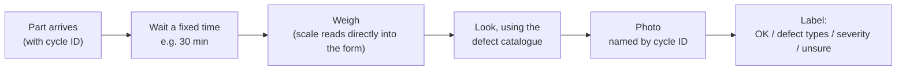

# Data collection plan for my own dataset

This plan turns the lessons from the public datasets into a recipe for collecting data on a real machine.
The public datasets were weakest **not in their sensors, but in how parts were labelled and linked to cycles**, so
most of this plan is about that.

**The one rule:** every cycle is logged, every part is labelled, and every part can be traced to its cycle.

---

## 1. Machine signals

| Priority | Record | Rate | Why (evidence in [Phase 4](../results/PHASE4_SUMMARY.md)) |
|---|---|---|---|
| **Must** | Screw position, melt/hydraulic pressure, clamp force — full curves, plus the machine's phase markers (injection / holding / dosing / cooling) | ≥ 100 Hz | strongest signals for defects (pressure) and weight (screw position, clamp force) |
| **Must** | Per-cycle values: cushion, injection stroke, dosing stroke, switchover position, injection peak, holding pressure, all phase times, cycle time | every cycle | defects were predicted as well from these as from full curves |
| **Must** | Mold temperature + coolant supply and return temperature per mold half | every cycle | mold temperature / heat removal matters for sink marks |
| **Must** | All setpoints, and every change with time stamp and who changed it | on change | needed to group experiments, validate honestly, and optimise settings |
| Should | Injection speed curve, screw rotation + torque during dosing | ≥ 100 Hz | sink marks; dose amount and melt state |
| Should | Barrel / nozzle zone temperatures (actual) | every cycle | context and drift detection |
| Optional | One cavity pressure sensor (near end of flow) | ≥ 100 Hz | best signal for short shots; worth it only where short shots are the main risk |
| Skip | Temperature-control pump / flow / power, hall air temperature and humidity | — | added nothing; at most note the hall climate once per shift |

**Two hardware levels:**

- **Level 1 (cheap):** read per-cycle values and setpoints from the controller (OPC-UA / EUROMAP 77 or 63) + two
  thermocouples per coolant circuit. Enough for defect detection.
- **Level 2:** add high-rate curves for screw position, pressure and clamp force (machine high-speed interface or
  analog taps). Needed for good weight prediction.

---

## 2. Linking each part to its cycle (the hardest practical step)

| Method | Effort | Reliability |
|---|---|---|
| **Numbered trays:** parts placed in slots in order; first cycle ID written on the tray; a check part marked every 50 cycles | low | medium — breaks if a part drops or a cycle is skipped |
| **Conveyor + light barrier counter** matched to the machine cycle counter | medium | good |
| **Mark the part:** date/counter insert in the mold, or laser / inkjet code printed at ejection | higher | best |

**Test the link on ~100 parts before the real campaign:** check that weights line up with shot sizes. A link that is
off by one silently ruins the whole dataset.

---

## 3. Inspection station and labelling rules

- **Fixed waiting time** before weighing and measuring (weight and size change while the part cools).
- **Defect catalogue with reference photos:** for each defect (sink marks, short shot, flash, streaks, burn marks,
  warpage) show an "OK", a "borderline" and a "not OK" example. Keeps labels consistent between people and days.
- **Severity, not only yes/no:** 0 = none, 1 = visible but acceptable, 2 = reject. Levels can be merged later, never split.
- **"Unsure" is allowed** — better than a forced guess.
- **Label blind:** the inspector does not see machine data or settings.
- **Quality check of the labels:** a second person relabels ~10 % of parts. If they often disagree, fix the defect
  definitions before training any model.

### Label table (one row per part)

| Column | Example |
|---|---|
| `cycle_id` | 184213 |
| `cavity` | 1 |
| `inspected_at` | 2027-03-02 14:31 |
| `inspector` | A |
| `weight_g` | 95.43 |
| `sprue_removed` | yes |
| `sink_marks`, `short_shot`, `flash`, `streaks`, `warpage` | 0 / 1 / 2 each |
| `overall` | OK / NOK / unsure |
| `photo_file` | 184213.jpg |
| `dims` (sampled parts only) | width_1 = 54.12, … |
| `notes` | "black speck near gate" |

**Tools:** minimum = scale with USB/RS232, phone camera, a spreadsheet or simple form. Better = a small local web
form that reads the scale and names the photo by cycle ID automatically.

---

## 4. Context data (stored, but never used as model inputs)

- Time stamp and machine cycle counter for **every** cycle, including warm-up (gaps broke the shot alignment in the
  public data).
- Mold ID, machine ID, material grade, **material lot**, regrind %, colour masterbatch, dryer settings / moisture.
- Event log: start-up, stop, alarm, mold cleaning, material or lot change, operator adjustment.
- Shift / operator.

These are needed to split data honestly (by day, by run) and to detect drift. As model inputs they would let the model
"recognise the day" instead of the part.

---

## 5. What to run

1. **Small designed experiment around the normal setting** — realistic variations (±5–15 %) of holding pressure,
   holding time, melt temperature, mold temperature, injection speed and switchover point; 30–50 setting points,
   15–20 parts each. Log the warm-up shots too and flag them instead of discarding them.
2. **Long stable runs at the normal setting** — several hundred to a few thousand parts over several days, including
   natural disturbances (start-up, material lot change, stop and restart, mold warming up). This is where single bad
   parts happen, and no public dataset contains it.
3. **Drift checks built in** — a centre-point setting repeated every day, a few settings repeated on different days,
   and 5–10 reference parts per day and material.
4. **At least 3–5 production days**, so a model can be tested on a day it never saw.

**Smallest useful version** (limited machine time): controller cycle values + setpoints, per-part weight and
OK/NOK with photos, a working part↔cycle link, ~20 setting points × 15 parts, and one stable run of 500+ parts over
two days.

---

## 6. File format

- One row per cycle: `cycle_id`, `timestamp`, setpoints, per-cycle values, curves stored as arrays (the SKZ parquet
  layout is a good template), units in column names.
- One label table (section 3), joined on `cycle_id` (+ `cavity`).
- Raw data is never edited; corrections go into code. A data dictionary is written from day one, stating for every
  column whether it is a **setting**, a **measurement** or a **label**.

---

## 7. From labelled data to a model

1. **Join** cycles and labels; count and explain cycles without a label.
2. **Audit** (as in Phase 1): missing values, constant columns, label rate per day/run, signals that only identify the day.
3. **Features** (as in Phase 2): per-cycle values + per-phase curve features (max, mean, area, slope) cut by the
   machine's phase markers.
4. **Start with weight regression** (every part has a weight). **Defect classification** once there are enough bad
   parts — roughly 30–50 defective parts from several separate events or days.
5. **Few defects?** Use **anomaly detection**: learn what normal cycles look like and flag cycles that look different.
6. **Validate by day or run**, never by random rows; always compare with simple baselines (majority class, a
   one-signal threshold, logistic regression).
7. **Recalibrate** the decision threshold and the weight offset with the daily reference parts.
8. **Explain** (as in Phase 4): check that the signals the model uses make physical sense.

Steps 2–8 already exist in this repository for the public datasets; a new dataset mainly needs a loader and the join.

**Later:** an inline scale gives a weight label for every part without manual work, and the inspection photos can
train an image model that takes over the visual check.
